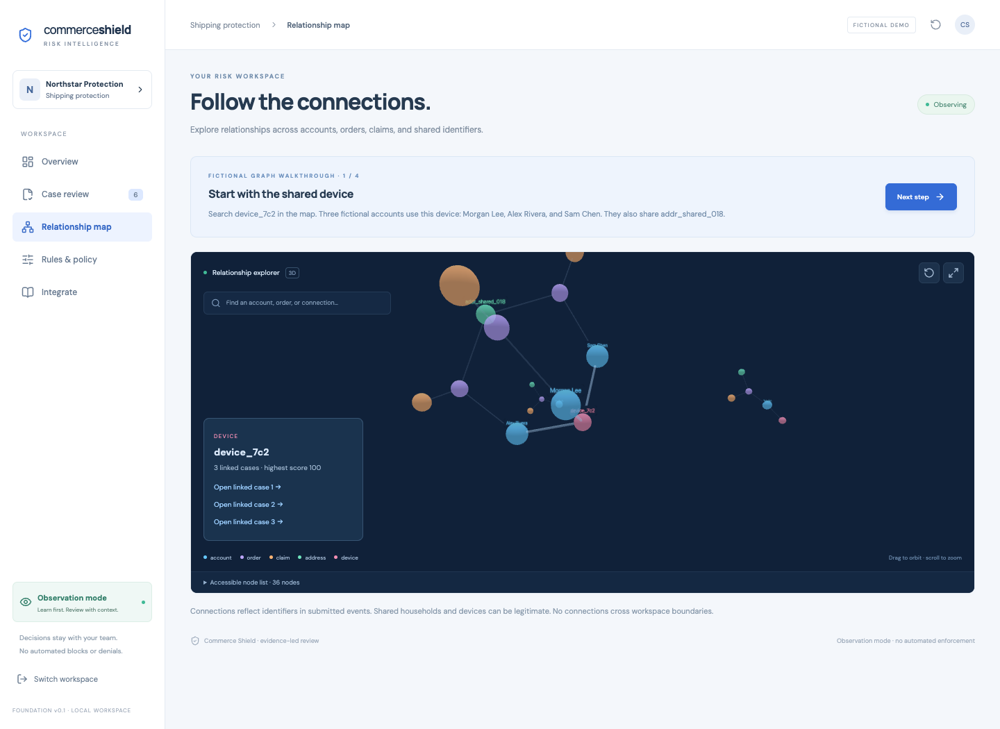

# Commerce Shield

A runnable fraud review foundation for **shipping protection** and **ecommerce refund abuse**. Select a niche, submit events, inspect explainable scores and relationships, and record human outcomes. Observation mode is mandatory; this app never blocks orders, denies claims, or issues payments.

**Local foundation, not a production fraud service.** No trained ML, detection accuracy claim, live Shopify connection, or real merchant data is included.

## Run locally

Requires Node.js 22.12+ and npm. SQLite is embedded. No external database or API key is needed for the fictional demo. If a prebuilt better-sqlite3 binary is unavailable, install your platform's C++ build tools.

```sh
git clone https://github.com/Biznomad/commerceshield.git
cd commerceshield
# Until the draft PR is merged:
git switch feat/fraud-foundation
npm ci
npm run dev
```

Open **http://127.0.0.1:5173** and select **Shipping demo** or **Refunds demo**. API: http://127.0.0.1:3001. Both bind to loopback. Development explicitly enables demo mode, which exposes known fictional keys and permits local workspace creation. Do not expose this mode to a network or use real customer data.

## Try the working graph

1. Open **Shipping demo → Relationship map** and follow the four-step walkthrough.
2. Search **device_7c2**. Morgan Lee, Alex Rivera, and Sam Chen share this fictional device and **addr_shared_018**, connecting three orders and claims.
3. Select a node and open a linked case. Inspect contributions, observed values, policy version and missing evidence.
4. Record a human outcome with your name and reasoning. Open **Integrate → Load audit trail** to see the saved review.

Drag to orbit, scroll to zoom, reset, or enter cinema view. Five colors distinguish accounts, orders, requests, address tokens and devices. A keyboard node list supports accessible navigation and WebGL fallback. Connections come from submitted events, not random decoration. Shared identifiers are context, not proof of abuse. See [the demo guide](docs/DEMO.md).



## Onboard your business

Enter a business name, select a niche, set a review threshold and choose a dashboard priority. Each niche sets distinct signals, evidence and review steps. Save the API key shown after creation. The server stores its SHA-256 hash; this browser tab keeps it in session storage. Sign out clears it. A local workspace key is not production staff identity/RBAC.

New workspaces start empty. Open **Integrate**, submit the editable sample JSON, and inspect the resulting case. **Rules & policy** adjusts enabled signals, weights, thresholds and metric order. Edits affect future events; historical assessments retain their policy. Niches cannot be changed in place: create a separate workspace to preserve review semantics.

## Build and validate

```sh
npm run check  # API/rules/isolation tests, typecheck, production UI build
npm audit
npm start      # built UI + API at http://127.0.0.1:3001
```

Start defaults to demo disabled. Existing demo keys in a development database still authenticate: use a fresh database for non-demo evaluation. For the built fictional demo: `DEMO_MODE=true npm start`. Both remain local-only. Shell variables configure the app; .env.example is documentation, not automatically loaded.

## Working features

| Area        | Behavior                                                                                        |
| ----------- | ----------------------------------------------------------------------------------------------- |
| Onboarding  | Two niches, isolated workspace, threshold, dashboard focus                                      |
| Engine      | Allowlisted numeric comparisons, additive score capped at 100, reason codes, versioned policies |
| Review      | Evidence checklist, playbook, human outcome and append-only API audit trail                     |
| API         | Workspace authentication, strict validation, idempotent retries, conflict rejection             |
| Graph       | Interactive 3D map, search, case drilldown, cinema/reset, keyboard directory                    |
| Persistence | Transactional SQLite WAL, hashed keys, tenant-scoped queries and isolation tests                |

Signal aggregates come from a trusted upstream adapter. The graph derives relationships but does not calculate 30-day velocities or linked-account aggregates. Evidence flags report presence, not independent verification. Scores are priorities, not fraud probabilities. Amounts are USD only.

## Adopt and extend

- [API contract and examples](docs/API.md)
- [Architecture and tradeoffs](docs/ARCHITECTURE.md)
- [Extension guide](docs/EXTENDING.md)
- [Security controls and release gates](docs/SECURITY.md)
- [Graph reference and dependency decisions](docs/DEPENDENCIES.md)

The [product brief](docs/PRODUCT.md) is broader than this release. [Roadmap](docs/ROADMAP.md) identifies remaining production work. Commerce Shield has no redistribution license selected yet; dependency licenses do not license the app. Select terms before distributing to adopters.
