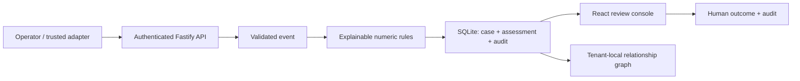

# Implemented local architecture

The earlier NestJS/Next.js/PostgreSQL proposal remains a future scaling option, not an implemented guarantee.

| Module                     | Responsibility                                                          |
| -------------------------- | ----------------------------------------------------------------------- |
| server/domain.ts           | Strict schemas, niche templates, safe comparisons and explanations      |
| server/store.ts            | Scoped queries/transactions, key hashing, persistence, graph derivation |
| server/app.ts              | Authentication, provisioning, validation, rate/body limits and routes   |
| server/seed.ts             | Fictional workspaces and shared-identifier clusters                     |
| src/App.tsx, src/Graph.tsx | Onboarding, console, policy, review, integration tester, 3D graph       |

## Policy and assessment

One immutable niche per workspace. Typed rules compare allowlisted numeric signals without executable expressions. Matched weights sum to a capped 0–100 score. At/above threshold or with any missing required evidence, the engine recommends review. No external enforcement exists.

Assessments snapshot reasons, values, policy version, niche, workflow, evidence requirements, engine version and observation status. Policy edits increment version and save the policy in audit. Prior scores remain unchanged. Identical externalId/payload retries replay; conflicting content returns 409.

Numeric aggregates are assertions from an authenticated adapter, not independently calculated velocities. No event-time/window aggregation service exists yet. Event kind must match the niche. Evidence presence does not verify the underlying document.

Every event creates a case, including low scores. One human outcome resolves it and appends audit. Reviewer names are self-attributed by workspace-key holders; verified staff identity, assignments, appeals and reopening require further implementation.

## Persistence and isolation

Bearer keys resolve to tenants server-side; caller tenant IDs are rejected. Every data query uses that tenant. Graph and audit derive from scoped records. Random keys are SHA-256 hashed; known demo keys are explicitly fictional. SQLite WAL and transactions persist state.

SQLite makes setup local and simple. It does not implement PostgreSQL RLS, encryption-at-rest, distributed queues or operational backups. Audit is append-only through the API, but database owners can edit files. Production requires RLS, migrations, staff identity/RBAC, key rotation, retention, backups and restore drills.

## Graph and runtime

React Force Graph 3D renders typed entities with placed/requested/ships-to/uses edges. Search focuses nodes; selection opens linked cases. Geometry is not predictive or historical. React renders text labels; the library HTML tooltip is disabled. A keyboard directory supports WebGL fallback.

The lazy-loaded Three.js graph bundle is relatively large (~1.4 MB minified in the initial build). Current graph projections read all tenant cases; pagination, limits and large-network load testing remain future work.

API binds 127.0.0.1; Vite proxies /api. Demo mode permits local provisioning and fictional credentials. Non-demo provisioning requires an admin token. Origin checks and rate limits do not replace production identity/TLS/XSS controls. Shopify OAuth, signed webhooks and payments are not implemented.
