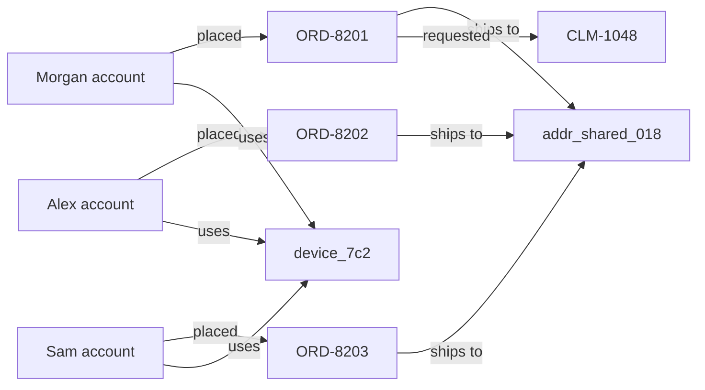

# Working relationship-graph demo

Run `npm ci && npm run dev`, open http://127.0.0.1:5173, select **Shipping demo → Relationship map**. Follow the four-step walkthrough. All people, identifiers and outcomes are fictional.

## Seeded workspaces

| Workspace            | Niche               | Cases      | Existing outcomes            |
| -------------------- | ------------------- | ---------- | ---------------------------- |
| Northstar Protection | Shipping protection | 8 claims   | 1 legitimate, 1 inconclusive |
| Fieldwork Goods      | Ecommerce refunds   | 8 requests | 1 legitimate, 1 inconclusive |

Each has its own key and separate records. Identical labels never create cross-workspace edges. Explicit demo mode seeds missing demos; restart never overwrites existing workspaces.

## Sample cluster

| Account     | Shipping case | Order    | Address         | Device     | USD |
| ----------- | ------------- | -------- | --------------- | ---------- | --- |
| Morgan Lee  | CLM-1048      | ORD-8201 | addr_shared_018 | device_7c2 | 640 |
| Alex Rivera | CLM-1049      | ORD-8202 | addr_shared_018 | device_7c2 | 215 |
| Sam Chen    | CLM-1050      | ORD-8203 | addr_shared_018 | device_7c2 | 380 |

Other accounts have distinct address/device tokens. Refund requests use RFD identifiers. Morgan has four claims in 30 days, a six-day-old account, pre-delivery claim timing, three linked accounts and a $640 order. Default shipping contributions: 30 + 15 + 20 + 25 + 10 = **100**. Alex and Sam score **70**. Missing delivery scans and proof of loss also trigger review. Five other samples score 0 with complete reported evidence; two are resolved.

Default shipping metrics: six open cases, three needing review, **$1,235** open review exposure, two outcomes. Exposure sums open review-recommended amounts; it is not estimated loss or detected fraud.

Nodes deduplicate by type/identifier within a workspace. Each carries linked case IDs and their maximum score, not an independently scored identity. Edges encode submitted relationships. Force layout distance is visual, not fraud likelihood or history. Shared households/devices can be legitimate.

## Explore end to end

1. Search device_7c2 and select it. The camera focuses the node; its panel lists three linked cases.
2. Open a case to inspect reasons, observed values, missing evidence and review steps.
3. Close the drawer; search addr_shared_018 to see the cluster from its address side.
4. Record a human outcome, refresh, and load the audit trail in Integrate to verify persistence.
5. Switch workspace to the refunds demo to compare rules and evidence requirements.

Reset fits the network; cinema expands it. The accessible node list opens the same node panel without pointer navigation or WebGL.

For a fresh demo without deleting data, stop the server and run `DATABASE_PATH=./data/fresh-demo.db npm run dev`. Never reset an operator's database without authorization.
